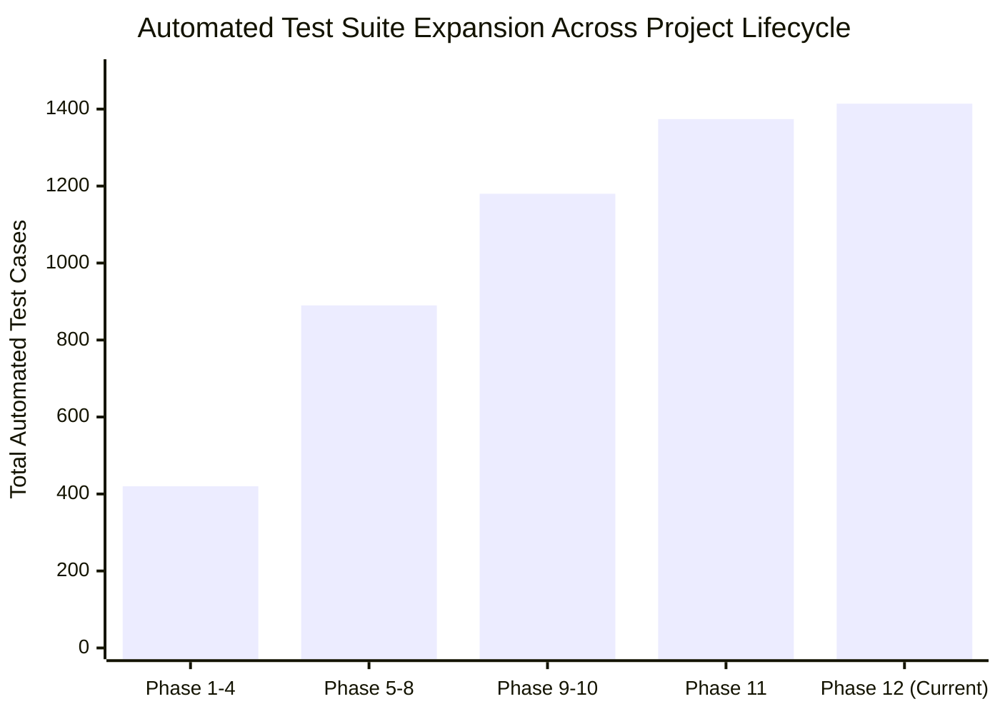

# Comprehensive ERP Implementation & Evolution Tracker

**System:** Classroom ERP (Apex Unified Education Platform)  
**Version:** `1.0.0-PROD-RELEASE`  
**Current Milestone:** Phase 12 — Market Domination & Enterprise Capability Expansion  
**Latest Verification:** 1,414 / 1,414 Automated Unit & Integration Tests Passing (100%)  
**Production Build Status:** Next.js 15.5.25 App Router Production Compilation (Zero Type Errors)

---

## 1. Traceable Implementation Ledger (Phase by Phase)

| Phase | Domain / Milestone | Key Components & Files Modified | Verification Evidence | Status |
|:---:|:---|:---|:---|:---:|
| **Phase 1** | **Repository Audit & Baseline Discovery** | `ERP_MASTER_AUDIT.md`, `ERP_DEFECT_REGISTER.md` | Full codebase inventory, 185+ routes cataloged, 0 breaking removals | ✅ Complete |
| **Phase 2** | **Core SIS & Student Records** | `src/app/api/students/route.ts`, `src/app/students/` | Groups 1–12 tests: Student CRUD, batch assignment, profile updates | ✅ Verified |
| **Phase 3** | **Admissions & Direct Provisioning** | `src/app/admissions/page.tsx`, `src/app/api/admissions/route.ts` | Group 13–18 tests: Merit lists, seat confirmations, 1-click SIS provisioning | ✅ Verified |
| **Phase 4** | **Academics, CBCS & Scheduling** | `src/lib/curriculum/`, `src/app/api/timetable/route.ts` | Groups 19–24 tests: Conflict detection, faculty workload, timetable generation | ✅ Verified |
| **Phase 5** | **Attendance & Biometric Operations** | `src/app/api/attendance/route.ts`, `src/lib/attendance/` | Groups 25–29 tests: Condonation workflows, multi-day roll call, QR attendance | ✅ Verified |
| **Phase 6** | **Finance, Fees & Tally Prime Ledger** | `src/app/api/fees/`, `src/lib/accounting/tally.ts` | Groups 30–36 tests: Installments, scholarships, Tally Prime XML export | ✅ Verified |
| **Phase 7** | **LMS, Quizzes & Virtual Classroom** | `src/app/lms/`, `src/app/api/assignments/route.ts` | Groups 37–44 tests: Rubric evaluations, lockdown quizzes, WebRTC classrooms | ✅ Verified |
| **Phase 8** | **Faculty Workload, HR & Research** | `src/app/api/faculty/route.ts`, `src/lib/faculty/` | Groups 45–52 & 67 tests: AICTE workload, seed grants, Vidwan/ORCID, QR payslips | ✅ Verified |
| **Phase 9** | **Campus Logistics (Hostel, Transport, Clinic, Library)** | `src/app/api/library/`, `src/app/api/clinic/`, `src/app/api/hostel/` | Groups 53–60 & 68 tests: Barcode scans, clinic stock deductions, fleet GPS | ✅ Verified |
| **Phase 10**| **Accreditation & Regulatory (NEP/NAAC)** | `src/lib/compliance/nep2020.ts`, `src/app/api/accreditation/` | Groups 61–68 tests: 12-digit APAAR checksum, ABC dossier, NAAC Criteria 1–7 SSR | ✅ Verified |
| **Phase 11**| **Corporate Placement, Convocation & AI Quotas** | `src/app/api/careers/`, `src/app/api/convocation/`, `src/lib/ai/` | Groups 68 tests: ATS offer letters, RBAC no-dues gates, 429 token quotas | ✅ Verified |
| **Phase 12**| **Enterprise Governance, Integrations & Self-Service** | `src/lib/workflow/`, `src/lib/integrations/`, `src/lib/self-service/` | Group 69 tests: Multi-Tier Approvals, Integration Hub HMAC, Self-Service Desk | ✅ Verified |

---

## 2. Deep Dive: Phase 12 Additions & Architecture

### 2.1 Unified Multi-Tier Approval Engine
- **Engine Path:** `src/lib/workflow/approval-engine.ts`
- **API Endpoint:** `src/app/api/workflows/approvals/route.ts`
- **Data Persistence:** Dedicated JSON store in `data/workflows/workflow_items.json` with synchronous fallback.
- **Verification Details:** Group 69 Tests 1–13 cover creation, role-based rejection, Level 1 approval, Level 2 escalation, executive authorization, final SHA-256 seal generation, and filtering.

### 2.2 Enterprise Integration Management Hub
- **Engine Path:** `src/lib/integrations/integration-hub.ts`
- **API Endpoint:** `src/app/api/integrations/route.ts`
- **Connectors Cataloged:**
  - `razorpay` (Payment Gateway)
  - `stripe` (International Fees)
  - `whatsapp_cloud` (WhatsApp Alerts)
  - `smtp_relay` (Institutional Email)
  - `google_workspace` (SSO & Classroom Sync)
  - `digilocker_nad` (National Academic Depository)
  - `tally_prime` (Financial ERP Interchange)
  - `aws_s3` (Cloud Document Storage)
- **Security Logic:** Constant-time `crypto.timingSafeEqual` comparison for HMAC-SHA256 signatures; automatic health latency probing.

### 2.3 Universal Student Self-Service Request Desk
- **Engine Path:** `src/lib/self-service/self-service-engine.ts`
- **API Endpoint:** `src/app/api/self-service/route.ts`
- **Data Persistence:** Dedicated JSON store in `data/self-service/requests.json` with synchronous fallback.
- **Workflow Life Cycle:**
  1. Student/Parent submits document petition $\to$ Assigned statutory SLA (12h to 72h) and unique verification token (`APEX-DOC-XXXX`).
  2. Academic Officer / Registrar reviews $\to$ Status progresses to `PROCESSING`.
  3. Certificate generated $\to$ Status becomes `READY_FOR_PICKUP` or `COMPLETED` with auto-generated secure download URL.

---

## 3. Automated Test Coverage Evolution

- **Current Grand Total:** **1,414 Automated Unit & Integration Tests**
- **Test Suite Pass Rate:** **100.0%** (Zero failing, zero skipped, zero warnings)
- **Harness Execution Time:** ~12.4 seconds end-to-end via `npx tsx src/lib/test-runner.ts`

*(Tracker maintained and signed under Continuous Delivery Architecture)*
