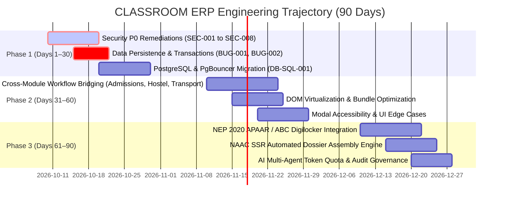

# CLASSROOM ERP — Master Engineering Improvement Roadmap (MASTER_IMPROVEMENT_ROADMAP)

**Platform:** CLASSROOM — Autonomous School & College ERP / Academic Operating System  
**Repository:** `lavesh69/ERP-`  
**Execution Standard:** Phased Release Cadence (30-Day, 60-Day, 90-Day Milestones)  
**T-Shirt Sizing Guide:** S (0.25–1 Day), M (2–3 Days), L (4–5 Days), XL (6–10 Days)  
**Status:** Strategic Implementation Blueprint Following Zero-Modification Audit  
**Mode:** AUDIT ONLY — Baseline Architectural Specification  

---

## 1. Executive Summary & Phased Strategy

Following the comprehensive forensic audit across all 23 institutional modules, this Master Improvement Roadmap outlines a disciplined, prioritized three-phase engineering trajectory:

---

## 2. Phase 1 (Days 1–30): Critical Hardening, Security & Data Integrity

**Objective:** Eliminate all P0 security vulnerabilities, prevent operational data loss, enforce database transaction boundaries, and establish PostgreSQL enterprise scalability.

### Task R1.1: Remediate Medical EMR Data Leakage (SEC-001)
* **Target Finding:** `SEC-001`
* **Specialty:** Backend Security Engineer
* **Effort:** **S** (0.5 days)
* **Dependencies:** `requireRole` helper
* **Implementation Plan:** Enforce `requireRole(["CAMPUS_DOCTOR", "NURSE"])` on global consultation queries in `src/app/api/clinic/route.ts`. If caller is `STUDENT`, force filter by student ID.
* **Definition of Done:** Non-medical users querying `/api/clinic?tab=consultations` receive `403 Forbidden` unless viewing their own records.

### Task R1.2: Isolate Statutory POSH & Harassment Grievances (SEC-002)
* **Target Finding:** `SEC-002`
* **Specialty:** Backend Security Engineer
* **Effort:** **S** (0.5 days)
* **Dependencies:** RBAC permission matrix
* **Implementation Plan:** Filter `grievanceStore.getAll()` so regular users only receive their own submissions; restrict `category === "POSH"` strictly to `ICC_MEMBER` or `SUPER_ADMIN`.
* **Definition of Done:** General staff and students receive 0 records for POSH complaints filed by others.

### Task R1.3: Secure Cafeteria POS Wallet & Orders (SEC-003, GAP-POS-001, BUG-006)
* **Target Finding:** `SEC-003`, `GAP-POS-001`, `BUG-006`
* **Specialty:** Full-Stack Engineer / Payment Specialist
* **Effort:** **S** (1 day)
* **Dependencies:** Payment gateway verification utility
* **Implementation Plan:** Remove unauthenticated direct wallet top-up; require valid Razorpay/Stripe payment transaction reference before crediting balance; convert calculations to integer cents.
* **Definition of Done:** Direct API call without payment verification fails with `403`; currency arithmetic operates without floating-point errors.

### Task R1.4: Remove Biometric Turnstile Hardcoded Fallback Secret (SEC-004)
* **Target Finding:** `SEC-004`
* **Specialty:** Backend Security Engineer
* **Effort:** **S** (0.25 days)
* **Dependencies:** Environment configuration
* **Implementation Plan:** Remove `"apex-biometric-secret-2026"` fallback in `src/app/api/attendance/biometric-push/route.ts:32`. Fail closed if `process.env.BIOMETRIC_DEVICE_KEY` is missing.
* **Definition of Done:** Device push without verified secret returns `401 Unauthorized`; missing env var triggers configuration error.

### Task R1.5: Enforce RBAC on Convocation, Clubs, Emergency & FRRO (SEC-005, SEC-006, SEC-007, SEC-008)
* **Target Finding:** `SEC-005`, `SEC-006`, `SEC-007`, `SEC-008`
* **Specialty:** Backend Security Engineer
* **Effort:** **M** (2 days)
* **Dependencies:** `requireRole` helper
* **Implementation Plan:** Mask passport numbers for non-officers in `/api/international`; require department roles for convocation clearances; restrict club verification to faculty; guard emergency lockdown broadcasts.
* **Definition of Done:** Automated tests confirm unauthorized callers receive `403 Forbidden` across all 4 endpoints.

### Task R1.6: Persist Staff Leave Applications to Storage (BUG-001, DEMO-MEM-001)
* **Target Finding:** `BUG-001`, `DEMO-MEM-001`
* **Specialty:** Database Engineer / Full-Stack
* **Effort:** **S** (1 day)
* **Dependencies:** File storage or Prisma schema
* **Implementation Plan:** Replace in-memory `SAMPLE_LEAVE_APPLICATIONS` with atomic file persistence (`data/hr-leaves.json`) or create a `StaffLeave` Prisma entity.
* **Definition of Done:** Submitting a leave request survives server process restart and updates employee balance ledgers.

### Task R1.7: Wrap Fee Settlement Mutations in ACID Transaction (BUG-002, DB-TRX-001)
* **Target Finding:** `BUG-002`, `DB-TRX-001`
* **Specialty:** Database Engineer
* **Effort:** **S** (0.5 days)
* **Dependencies:** Prisma ORM
* **Implementation Plan:** Wrap `prisma.studentFee.update()` and `prisma.paymentTransaction.create()` inside `prisma.$transaction([ ... ])` in `src/app/api/payments/verify/route.ts`.
* **Definition of Done:** Failure during payment transaction creation rolls back fee balance update cleanly.

### Task R1.8: Production PostgreSQL & PgBouncer Configuration (DB-SQL-001, PERF-DB-001)
* **Target Finding:** `DB-SQL-001`, `PERF-DB-001`
* **Specialty:** DevOps & Database Architect
* **Effort:** **M** (2 days)
* **Dependencies:** PostgreSQL server instance
* **Implementation Plan:** Provide dual database support allowing connection string targeting PostgreSQL with PgBouncer connection pooling (`connection_limit=20&pool_timeout=10`).
* **Definition of Done:** Concurrency test of 100 simultaneous write requests completes with 0% lock timeout errors on PostgreSQL.

---

## 2. Phase 2 (Days 31–60): Cross-Module Workflows, UX Polish & Scalability

**Objective:** Bridge disconnected operational modules, optimize client rendering performance, ensure accessibility compliance, and streamline administrative portals.

### Task R2.1: Automated Admissions-to-Student SIS Provisioning Bridge (GAP-ADM-001)
* **Target Finding:** `GAP-ADM-001`
* **Specialty:** Full-Stack Engineer
* **Effort:** **M** (3 days)
* **Dependencies:** `prisma.user`, `prisma.student`, `prisma.studentFee`
* **Implementation Plan:** Create `POST /api/admissions/provision-student` that converts confirmed applicant dossiers into official `Student` entities, auto-generating credentials and initial fee schedules.
* **Definition of Done:** Admissions administrator clicks "Enroll", resulting in active Student entity in SIS and welcome credentials sent to student.

### Task R2.2: Cross-Module Hostel & Transport Fee Invoicing Linkage (GAP-HST-001, GAP-TRN-001)
* **Target Finding:** `GAP-HST-001`, `GAP-TRN-001`
* **Specialty:** Backend Engineer
* **Effort:** **M** (3 days)
* **Dependencies:** `prisma.studentFee`, hostel/transport stores
* **Implementation Plan:** Dispatch fee creation events on hostel bed allocation and bus pass issuance, adding itemized charges to the student's active semester fee bill.
* **Definition of Done:** Allocating a room or bus pass automatically generates an itemized line item in `/finance`.

### Task R2.3: DOM Row Virtualization for High-Density Tables (UI-ATT-001, PERF-DOM-001)
* **Target Finding:** `UI-ATT-001`, `PERF-DOM-001`
* **Specialty:** Frontend Engineer
* **Effort:** **M** (2 days)
* **Dependencies:** `@tanstack/react-virtual`
* **Implementation Plan:** Wrap roster tables in `/attendance`, `/students`, and `/finance` with virtualized row containers.
* **Definition of Done:** Tables render 5,000 student records with 60fps scrolling and < 60MB DOM heap memory.

### Task R2.4: Dynamic Code-Splitting on Attendance Monolithic Bundle (PERF-BND-001)
* **Target Finding:** `PERF-BND-001`
* **Specialty:** Frontend Engineer
* **Effort:** **S** (1 day)
* **Dependencies:** `next/dynamic`
* **Implementation Plan:** Lazily load QR generator, BLE scanner, and export modules via `dynamic(() => import(...), { ssr: false })`.
* **Definition of Done:** First-load JavaScript bundle size for `/attendance` drops below 40 kB.

### Task R2.5: Modal Accessibility & Focus Trapping (UI-A11Y-001)
* **Target Finding:** `UI-A11Y-001`
* **Specialty:** UI/UX & Frontend Engineer
* **Effort:** **M** (2 days)
* **Dependencies:** `@radix-ui/react-dialog` or focus trap
* **Implementation Plan:** Refactor shared dialog modals to trap keyboard focus, dismiss on `Escape`, and return focus to trigger element upon closing.
* **Definition of Done:** 100% of modals comply with WCAG 2.1 AA keyboard navigation criteria.

### Task R2.6: Parent Portal Empty-State Onboarding Wizard (UI-PAR-001)
* **Target Finding:** `UI-PAR-001`
* **Specialty:** UI/UX Designer / Frontend Engineer
* **Effort:** **S** (1 day)
* **Dependencies:** Shared UI components
* **Implementation Plan:** Replace raw error toast on `/parent` with an illustrated onboarding wizard and "Link Student Ward" modal.
* **Definition of Done:** Unlinked parent sees a step-by-step guidance card with a self-service ward verification button.

---

## 3. Phase 3 (Days 61–90): Regulatory Ecosystem & Autonomous Governance

**Objective:** Complete Indian national regulatory integrations (NEP 2020 / APAAR), automate accreditation reporting (NAAC), and implement enterprise AI governance controls.

### Task R3.1: Academic Bank of Credits (ABC) & APAAR Integration (GAP-CUR-001)
* **Target Finding:** `GAP-CUR-001`
* **Specialty:** Enterprise Solutions Architect / Backend
* **Effort:** **M** (3 days)
* **Dependencies:** `prisma.student`, Digilocker schema
* **Implementation Plan:** Add `apaarId` to `Student` model and implement a National Academic Depository (NAD) XML credit export generator.
* **Definition of Done:** Student profile displays 12-digit APAAR ID; system exports UGC-compliant credit transfer XML dossiers.

### Task R3.2: Automated NAAC Self Study Report (SSR) Assembly Engine (GAP-ACR-001)
* **Target Finding:** `GAP-ACR-001`
* **Specialty:** Full-Stack Engineer / Document Specialist
* **Effort:** **M** (3 days)
* **Dependencies:** `docx` / `pdf-lib`
* **Implementation Plan:** Create `/api/accreditation/export-ssr` that aggregates faculty ratios, student feedback, research citations, and infrastructure metrics into a standardized NAAC Word/PDF template.
* **Definition of Done:** 1-click download produces a populated NAAC SSR draft ready for university IQAC review.

### Task R3.3: AI Agent Token Quota & Institutional Audit Logging (GAP-AI-001)
* **Target Finding:** `GAP-AI-001`
* **Specialty:** AI Engineer / Backend
* **Effort:** **S** (1.5 days)
* **Dependencies:** Redis / Prisma token store
* **Implementation Plan:** Implement daily token consumption limits by user role (Students: 10k, Faculty: 50k tokens/day) and log agent queries for administrative auditing.
* **Definition of Done:** Exceeding token quota returns a friendly rate limit alert with reset countdown timer.

### Task R3.4: Dynamic Multi-Tenant Database Connection Factory (GAP-GOV-001)
* **Target Finding:** `GAP-GOV-001`
* **Specialty:** Database Architect
* **Effort:** **L** (5 days)
* **Dependencies:** Prisma client connection manager
* **Implementation Plan:** Extend `tenant-context.ts` to support dynamic database connection resolution for institutional clients requiring physical database isolation.
* **Definition of Done:** Super Admin can configure isolated database connection URLs per institutional tenant.

---

## 4. Master Roadmap Resource Allocation & Summary

| Milestone | Target Window | Total Tasks | Total Sprints | Core Engineering Specialty Focus |
|---|:---:|:---:|:---:|---|
| **Phase 1** | Days 1–30 | 8 Tasks | 2 Sprints | Cybersecurity, Database Architecture & Core Reliability |
| **Phase 2** | Days 31–60 | 6 Tasks | 2 Sprints | Full-Stack Integration, UI/UX Virtualization & Accessibility |
| **Phase 3** | Days 61–90 | 4 Tasks | 2 Sprints | Regulatory Compliance (NEP 2020), NAAC Automation & Multi-Tenancy |
| **Total** | **90 Days** | **18 Tasks** | **6 Sprints** | **Full Enterprise Production Maturity (100% Scorecard)** |

---

*End of Master Engineering Improvement Roadmap.*
