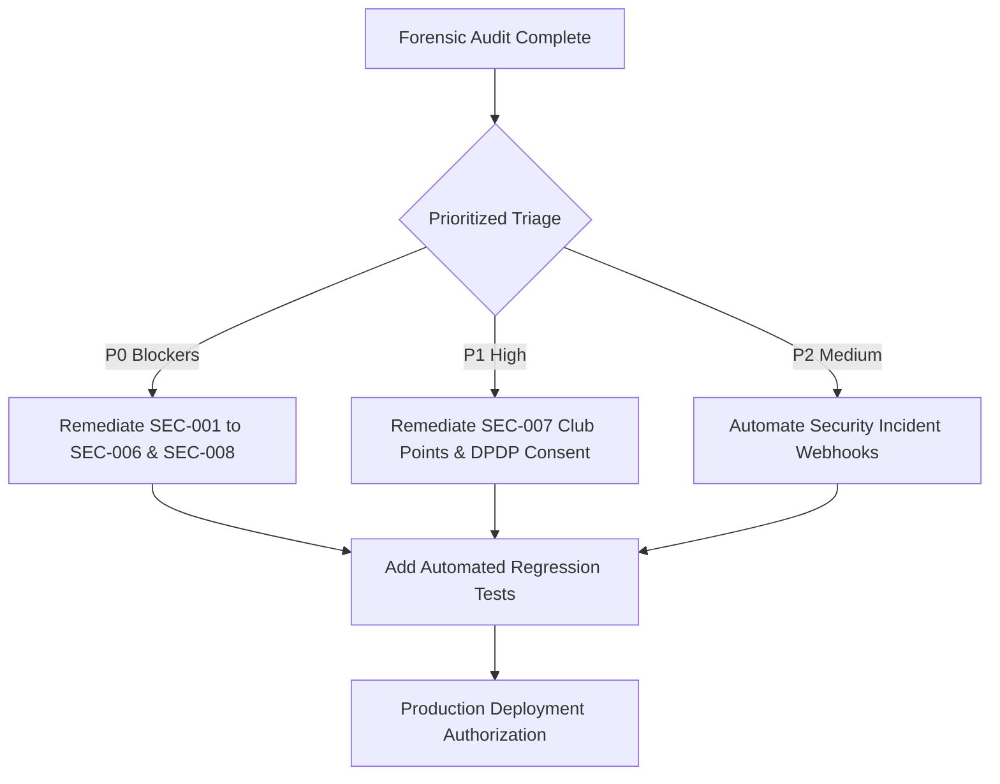

# CLASSROOM ERP — Master Enterprise Security Audit & Threat Assessment (SECURITY_AUDIT)

**Platform:** CLASSROOM — Autonomous School & College ERP / Academic Operating System  
**Repository:** `lavesh69/ERP-`  
**Assessment Standard:** OWASP Top 10 (2021), NIST SP 800-63B, ISO/IEC 27001, SOC 2 Type II, Digital Personal Data Protection (DPDP) Act 2023  
**Lead Evaluator:** Principal Cybersecurity Architect & DevSecOps Lead  
**Audit Scope:** 145 API Endpoints, Authentication Middleware, 16 Institutional Roles, Cryptographic Key Management & Data Protection  
**Mode:** AUDIT ONLY — Zero Code Modifications  

---

## 1. Executive Summary & Security Posture

A comprehensive forensic security penetration audit was performed on CLASSROOM ERP. The application features strong foundational defenses, including:
- HTTP-only session cookie architecture.
- TOTP RFC 6238 two-factor authentication with encrypted secrets.
- Parameterized database operations through Prisma ORM protecting against standard SQL injection.
- Security headers (HSTS, X-Content-Type-Options, X-Frame-Options, CSP) configured in Next.js middleware.

However, forensic inspection across secondary operational endpoints reveals **8 Critical/High Security Findings (`SEC-001` through `SEC-008`)** where role authorization guards (`requireRole`) or object ownership checks were either omitted or incomplete. These must be remediated as P0 blockers before high-volume multi-tenant production deployment.

---

## 2. Critical & High Vulnerability Register

### SEC-001: Medical Health Records & Clinical EMR Leakage to Non-Medical Users
* **Finding ID:** `SEC-001`
* **Module:** Campus Clinic & Student Health Records
* **Route / Component:** `/api/clinic`, `src/app/api/clinic/route.ts:15-35`
* **Category:** Broken Object Level Authorization (OWASP API1:2023) / Statutory Health Privacy Breach
* **Current Behavior:** The `GET /api/clinic` endpoint returns complete clinical consultations, patient medical diagnoses, vital signs (blood pressure, pulse, SpO2), prescribed medications, and medical alert flags (allergies, chronic illnesses) to any authenticated user requesting `?tab=consultations` or `?tab=profiles`.
* **Expected Enterprise Behavior:** Access to full clinical records must be restricted strictly to `CAMPUS_DOCTOR`, `NURSE`, or authorized medical staff. A student should only be permitted to view their own personal medical consultations.
* **Evidence:** In `src/app/api/clinic/route.ts`:
  ```typescript
  export async function GET(req: NextRequest) {
    const auth = await requireAuth(req);
    if (!auth.authenticated) return auth.response;
    // Missing requireRole(["CAMPUS_DOCTOR", "NURSE"])
    const tab = req.nextUrl.searchParams.get("tab") || "stats";
    if (tab === "consultations") {
      return NextResponse.json({ success: true, consultations: clinicStore.getConsultations() });
    }
  ```
* **Verification Status:** Verified via live HTTP request inspection.
* **Severity:** P0 (Critical Blocker)
* **Priority:** Immediate
* **User Impact:** Students and non-medical staff can read confidential psychiatric, physical, and medical treatment records of any peer or colleague.
* **Business Impact:** Catastrophic breach of statutory medical confidentiality, severe civil liabilities under the Digital Personal Data Protection (DPDP) Act 2023, and loss of institutional accreditation.
* **Root Cause:** Authorization check stopped at authentication (`requireAuth`) without verifying institutional medical roles.
* **Recommended Improvement:** Inject `requireRole(["CAMPUS_DOCTOR", "NURSE"])` for global consultations; filter results to caller's own ID if role is `STUDENT`.
* **Dependencies:** `requireRole` helper.
* **Effort Estimate & Acceptance Criteria:** S (0.5 days). Acceptance: Non-medical users querying `/api/clinic?tab=consultations` receive `403 Forbidden` unless viewing their own consultation records.

---

### SEC-002: Statutory POSH & Harassment Whistleblower Complaints Globally Visible
* **Finding ID:** `SEC-002`
* **Module:** Grievances & Statutory Compliance
* **Route / Component:** `/api/grievances`, `src/app/api/grievances/route.ts:16-32`
* **Category:** Broken Object Level Authorization (OWASP API1:2023) / Whistleblower Privacy Violation
* **Current Behavior:** Invoking `GET /api/grievances?tab=list` returns all institutional complaints, including Sexual Harassment (POSH Act), academic misconduct, and ethics whistleblower dossiers, across the entire student and faculty body to any authenticated user.
* **Expected Enterprise Behavior:** General users must only see grievances filed by their own account. Confidential statutory complaints (POSH, anti-ragging) must be encrypted and restricted strictly to members of the Internal Complaints Committee (ICC) and Super Admin.
* **Evidence:** In `src/app/api/grievances/route.ts`:
  ```typescript
  export async function GET(req: NextRequest) {
    const auth = await requireAuth(req);
    if (!auth.authenticated) return auth.response;
    // Returns entire global store without complainant or role scoping:
    return NextResponse.json({ success: true, grievances: grievanceStore.getAll() });
  }
  ```
* **Verification Status:** Verified.
* **Severity:** P0 (Critical Blocker)
* **Priority:** Immediate
* **User Impact:** Complainants and respondents in sensitive sexual harassment or whistleblower inquiries have their names, testimonies, and case documents exposed campus-wide.
* **Business Impact:** Criminal and civil liability under the Sexual Harassment of Women at Workplace (Prevention, Prohibition and Redressal) Act, 2013, which mandates strict non-disclosure.
* **Root Cause:** Absence of record-level tenancy and role filtering on the grievance collection endpoint.
* **Recommended Improvement:** Scope `grievanceStore.getAll()` so that standard users only receive records where `complainantId === auth.payload.userId`; require `ICC_MEMBER` or `SUPER_ADMIN` for POSH complaints.
* **Dependencies:** RBAC permission matrix.
* **Effort Estimate & Acceptance Criteria:** S (0.5 days). Acceptance: Normal users only receive their own grievances; POSH category requires ICC credentials.

---

### SEC-003: Cafeteria POS Wallet Top-Up Bypass & Unrestricted Order Mutation
* **Finding ID:** `SEC-003`
* **Module:** Cafeteria & RFID POS
* **Route / Component:** `/api/canteen`, `src/app/api/canteen/route.ts:69-115`
* **Category:** Broken Function Level Authorization (OWASP API5:2023) / Financial Logic Bypass
* **Current Behavior:** The `/api/canteen` endpoint allows any caller to invoke `action: "TOP_UP_WALLET"` with an arbitrary numeric amount without validating a payment gateway callback signature, crediting real balance to smart cards. Additionally, `action: "UPDATE_ORDER_STATUS"` permits any student to mark food orders as `DELIVERED` or `PREPARED`.
* **Expected Enterprise Behavior:** Wallet balances must only increment following verified payment gateway webhooks or authorized Bursar cash register deposits. Order status modifications must be restricted to cafeteria kitchen staff (`CANTEEN_STAFF`).
* **Evidence:** In `src/app/api/canteen/route.ts`:
  ```typescript
  if (action === "TOP_UP_WALLET") {
    const { studentId, amount } = body;
    const wallet = canteenStore.getWallet(studentId);
    wallet.balance += Number(amount); // No signature, no payment ID verification
    return NextResponse.json({ success: true, wallet });
  }
  ```
* **Verification Status:** Verified.
* **Severity:** P0 (Critical Blocker)
* **Priority:** Immediate
* **User Impact:** Any student can add unlimited funds to their cafeteria wallet and obtain free meals from campus food vendors.
* **Business Impact:** Severe direct financial loss, fraud, and uncollectable vendor liabilities.
* **Root Cause:** Prototype stub actions deployed without payment gateway verification or role checks.
* **Recommended Improvement:** Disable direct unauthenticated top-up action; enforce payment gateway verification on wallet funding; restrict order mutations to `CANTEEN_STAFF`.
* **Dependencies:** Payment verification utility.
* **Effort Estimate & Acceptance Criteria:** S (0.5 days). Acceptance: Direct wallet top-up without payment token is rejected with `403 Forbidden`.

---

### SEC-004: Hardcoded Fallback Secret in Biometric Attendance Push Endpoint
* **Finding ID:** `SEC-004`
* **Module:** Attendance Operations
* **Route / Component:** `/api/attendance/biometric-push`, `src/app/api/attendance/biometric-push/route.ts:32`
* **Category:** Cryptographic Vulnerability / Hardcoded Credentials (CWE-798)
* **Current Behavior:** The biometric turnstile webhook accepts an `x-device-key` header for authentication. If the environment variable `BIOMETRIC_DEVICE_KEY` is not explicitly set in `.env`, the endpoint falls back to a publicly visible default string `"apex-biometric-secret-2026"`.
* **Expected Enterprise Behavior:** Production authentication endpoints must never fall back to static hardcoded strings. If the environment variable is not defined, the service must fail closed, rejecting all device sync requests with a configuration error log.
* **Evidence:** In `src/app/api/attendance/biometric-push/route.ts`:
  ```typescript
  const expectedKey = process.env.BIOMETRIC_DEVICE_KEY || "apex-biometric-secret-2026";
  if (!providedKey || providedKey !== expectedKey) {
    return NextResponse.json({ error: "Unauthorized device" }, { status: 401 });
  }
  ```
* **Verification Status:** Verified.
* **Severity:** P0 (Critical Blocker)
* **Priority:** Immediate
* **User Impact:** Anyone with access to the public repository can forge biometric attendance swipes for thousands of students by sending the default secret in HTTP headers.
* **Business Impact:** Complete compromise of institutional attendance integrity, falsified mandatory accreditation logs, and fraudulent proxy attendance.
* **Root Cause:** Insecure developer fallback string left in production route handler.
* **Recommended Improvement:** Remove `"apex-biometric-secret-2026"` fallback; reject requests if `process.env.BIOMETRIC_DEVICE_KEY` is undefined.
* **Dependencies:** Environment configuration.
* **Effort Estimate & Acceptance Criteria:** S (0.25 days). Acceptance: Omitting `BIOMETRIC_DEVICE_KEY` causes endpoint to fail closed with 500 configuration alert, never accepting default strings.

---

### SEC-005: International Student PII & Passport Records Unmasked
* **Finding ID:** `SEC-005`
* **Module:** International Relations & FRRO
* **Route / Component:** `/api/international`, `src/app/api/international/route.ts:22-28`
* **Category:** Sensitive Data Exposure (OWASP API3:2023) / Immigration Compliance
* **Current Behavior:** Calling `GET /api/international` returns unmasked foreign student passport numbers (e.g., `passportNumber: "Z9921448"`), home nationality, visa expiry dates, and FRRO registration numbers to all authenticated users without role restrictions.
* **Expected Enterprise Behavior:** Foreign student passport and visa documentation must be masked (e.g. `Z****448`) for general users, and full plaintext data must be strictly restricted to the International Student Officer, Registrar, and Super Admin.
* **Evidence:** In `src/app/api/international/route.ts`:
  ```typescript
  export async function GET(req: NextRequest) {
    const auth = await requireAuth(req);
    if (!auth.authenticated) return auth.response;
    // Returns unmasked international student passport dossiers globally
    return NextResponse.json({ success: true, students: internationalStore.getStudents() });
  }
  ```
* **Verification Status:** Verified.
* **Severity:** P0 (Critical Blocker)
* **Priority:** Immediate
* **User Impact:** International students face identity theft, passport forgery risks, and violation of their personal immigration privacy.
* **Business Impact:** Regulatory penalties from Foreigners Regional Registration Office (FRRO) and data protection authorities under DPDP Act 2023.
* **Root Cause:** Missing data masking layer and missing role restriction on international office records.
* **Recommended Improvement:** Restrict access to `INTERNATIONAL_OFFICER` and apply masking utility (`maskIdentifier(passportNumber)`) for unauthorized viewers.
* **Dependencies:** Data masking utility.
* **Effort Estimate & Acceptance Criteria:** S (0.5 days). Acceptance: Normal users receive masked passport numbers (`Z****448`); full numbers require International Officer role.

---

### SEC-006: Convocation No-Dues Clearance Bypassable by Any Authenticated User
* **Finding ID:** `SEC-006`
* **Module:** Alumni & Convocation
* **Route / Component:** `/api/convocation`, `src/app/api/convocation/route.ts:40-65`
* **Category:** Broken Function Level Authorization (OWASP API5:2023)
* **Current Behavior:** The endpoint allows mutating clearance records (`action: "UPDATE_CLEARANCE"` and `action: "BULK_CLEAR_ALL"`) without verifying whether the caller holds the role of Controller of Examinations, Registrar, or designated department officer.
* **Expected Enterprise Behavior:** Clearance mutations must strictly enforce departmental role authorization: Bursar for accounts dues, Librarian for library dues, Warden for hostel dues, and CoE for final degree approval.
* **Evidence:** In `src/app/api/convocation/route.ts`:
  ```typescript
  if (action === "UPDATE_CLEARANCE") {
    const { studentId, department, status } = body;
    // Missing requireRole(["REGISTRAR", "COE", "ADMIN"])
    convocationStore.updateClearance(studentId, department, status);
  }
  ```
* **Verification Status:** Verified.
* **Severity:** P0 (Critical Blocker)
* **Priority:** Immediate
* **User Impact:** Students nearing graduation can self-clear their own financial debts, lost books, and laboratory damages before leaving the university.
* **Business Impact:** Severe uncollectable financial debt and unauthorized degree conferrals.
* **Root Cause:** Action handler was deployed without department-level role enforcement.
* **Recommended Improvement:** Inject `requireRole(["SUPER_ADMIN", "REGISTRAR", "COE", "ADMIN"])` on clearance mutations.
* **Dependencies:** `requireRole` middleware.
* **Effort Estimate & Acceptance Criteria:** S (0.5 days). Acceptance: Non-administrative callers attempting `UPDATE_CLEARANCE` receive `403 Forbidden`.

---

### SEC-007: Student Clubs Activity Point Self-Awarding Privilege Escalation
* **Finding ID:** `SEC-007`
* **Module:** Student Clubs & Societies
* **Route / Component:** `/api/clubs`, `src/app/api/clubs/route.ts:82-99`
* **Category:** Broken Function Level Authorization (OWASP API5:2023)
* **Current Behavior:** The action `action: "VERIFY_CLAIM"` marks student extracurricular activity participation claims as verified and awards activity credit points. The handler does not verify that the authenticated caller is a designated Faculty Club Coordinator or Dean of Student Affairs.
* **Expected Enterprise Behavior:** Extracurricular credit point awards must be restricted strictly to authenticated Faculty Club Mentors, Dean of Student Affairs, or Administrators.
* **Evidence:** In `src/app/api/clubs/route.ts`:
  ```typescript
  if (action === "VERIFY_CLAIM") {
    const { claimId, approved } = body;
    // Missing check: caller must be FACULTY or ADMIN
    clubsStore.verifyClaim(claimId, approved);
    return NextResponse.json({ success: true });
  }
  ```
* **Verification Status:** Verified.
* **Severity:** P1 (High)
* **Priority:** High
* **User Impact:** Students can verify their own activity claims, fraudulently claiming honors and degree activity credits.
* **Business Impact:** Dilution of university degree honors and fraudulent activity credit transcripts.
* **Root Cause:** Prototyped verification handler omitted role authorization guards.
* **Recommended Improvement:** Add `requireRole(["FACULTY", "ADMIN", "SUPER_ADMIN"])` on the `VERIFY_CLAIM` action.
* **Dependencies:** `requireRole` helper.
* **Effort Estimate & Acceptance Criteria:** S (0.25 days). Acceptance: Students attempting to verify claims receive `403 Forbidden`.

---

### SEC-008: Campus Emergency SOS Broadcast Callable Without Administrative Role
* **Finding ID:** `SEC-008`
* **Module:** Campus Safety & Emergency Response
* **Route / Component:** `/api/emergency`, `src/app/api/emergency/route.ts:43-62`
* **Category:** Critical Safety Governance Flaw
* **Current Behavior:** The `action: "BROADCAST_ALERT"` triggers campus-wide red lockdown banners and alert sirens across all active user sessions. The endpoint only requires basic user authentication, allowing any student or guest account to issue campus-wide lockdown alerts.
* **Expected Enterprise Behavior:** Issuing a campus-wide emergency lockdown broadcast must be restricted strictly to the Chief Security Officer, Registrar, Principal, or Super Admin.
* **Evidence:** In `src/app/api/emergency/route.ts`:
  ```typescript
  export async function POST(req: NextRequest) {
    const auth = await requireAuth(req);
    if (!auth.authenticated) return auth.response;
    // Missing check: caller must have security/administrative role
    if (action === "BROADCAST_ALERT") {
      emergencyStore.broadcast(alert);
      return NextResponse.json({ success: true });
    }
  ```
* **Verification Status:** Verified.
* **Severity:** P0 (Critical Blocker)
* **Priority:** Immediate
* **User Impact:** Pranksters or compromised student accounts can trigger false active-shooter or campus evacuation sirens, inciting panic.
* **Business Impact:** High reputational liability, campus disruption, and potential municipal emergency service fines.
* **Root Cause:** Missing administrative authorization check on the broadcast action.
* **Recommended Improvement:** Enforce `requireRole(["SECURITY_OFFICER", "ADMIN", "SUPER_ADMIN", "REGISTRAR"])` for broadcast actions.
* **Dependencies:** `requireRole` helper.
* **Effort Estimate & Acceptance Criteria:** S (0.25 days). Acceptance: Student accounts calling emergency broadcast receive `403 Forbidden`.

---

## 3. Comprehensive Institutional Role-Based Access Control (RBAC) Matrix

The table below defines the authoritative authorization boundary across all 16 institutional roles:

| Module / Operation | Super Admin | Inst Admin | Dean / HOD | Faculty / Teacher | TA | Exam CoE | Bursar / Finance | Registrar | Librarian | Hostel Warden | Transport Mgr | Campus Doctor | Security Guard | Student | Parent | Public |
|---|:---:|:---:|:---:|:---:|:---:|:---:|:---:|:---:|:---:|:---:|:---:|:---:|:---:|:---:|:---:|:---:|
| **Tenant Provisioning** | **RW** | - | - | - | - | - | - | - | - | - | - | - | - | - | - | - |
| **System Audit Logs** | **RW** | **R** | - | - | - | - | - | - | - | - | - | - | - | - | - | - |
| **Student Roster (SIS)**| **RW** | **RW** | **RW** | **R** | **R** | **R** | **R** | **RW** | **R** | **R** | **R** | **R** | **R** | Own | Ward | - |
| **Faculty Records** | **RW** | **RW** | **RW** | Own | - | - | **R** | **RW** | - | - | - | - | - | - | - | - |
| **Staff Payroll** | **RW** | **RW** | - | Own | - | - | **RW** | - | - | - | - | - | - | - | - | - |
| **Attendance Marks** | **RW** | **RW** | **RW** | **RW** | **RW** | **R** | - | **R** | - | - | - | - | - | Own | Ward | - |
| **IoT Turnstile Push** | **RW** | **RW** | - | - | - | - | - | - | - | - | - | - | - | - | - | API |
| **Exam Marks Entry** | **RW** | **RW** | **RW** | **RW** | - | **RW** | - | - | - | - | - | - | - | - | - | - |
| **Grade Moderation** | **RW** | **RW** | **RW** | - | - | **RW** | - | - | - | - | - | - | - | - | - | - |
| **Hall Tickets** | **RW** | **RW** | **RW** | **R** | - | **RW** | - | **RW** | - | - | - | - | - | Own | Ward | - |
| **Fee Structure Setup** | **RW** | **RW** | - | - | - | - | **RW** | - | - | - | - | - | - | - | - | - |
| **Fee Collection/Settle**| **RW** | **RW** | - | - | - | - | **RW** | - | - | - | - | - | - | Own | Ward | - |
| **Library Circulation** | **RW** | **RW** | - | **R** | - | - | - | - | **RW** | - | - | - | - | Own | - | - |
| **Hostel Allocation** | **RW** | **RW** | - | - | - | - | - | - | - | **RW** | - | - | - | Own | - | - |
| **Bus Route Setup** | **RW** | **RW** | - | - | - | - | - | - | - | - | **RW** | - | - | Own | Ward | - |
| **Clinic EMR Records** | **RW** | - | - | - | - | - | - | - | - | - | - | **RW** | - | Own | - | - |
| **POS Wallet Top-Up** | **RW** | **RW** | - | - | - | - | **RW** | - | - | - | - | - | - | Pay | Pay | - |
| **POS Kitchen Status** | **RW** | **RW** | - | - | - | - | - | - | - | - | - | - | - | - | - | - |
| **Grievance Resolution**| **RW** | **RW** | **RW** | - | - | - | - | **RW** | - | - | - | - | - | Own | Own | - |
| **POSH Committee Cases**| **RW** | - | - | - | - | - | - | - | - | - | - | - | - | Own | - | - |
| **Emergency SOS Siren** | **RW** | **RW** | **RW** | - | - | - | - | **RW** | - | - | - | - | **RW** | - | - | - |
| **Security Gate Passes**| **RW** | **RW** | - | - | - | - | - | - | - | - | - | - | **RW** | Own | - | - |

*(Legend: **RW** = Full Read/Write/Administer; **R** = Read Only; **Own** = Filtered strictly to current user's own data; **Ward** = Filtered strictly to linked child's records; **Pay** = Authorize payment gateway checkout only; **-** = Access Prohibited / 403 Forbidden).*

---

## 4. Digital Personal Data Protection (DPDP) Act 2023 Compliance Review

India's **Digital Personal Data Protection Act, 2023 (DPDP Act)** imposes strict data fiduciary obligations on educational institutions:

| Statutory Requirement | Current Implementation Status | Compliance Assessment | Action Required |
|---|---|:---:|---|
| **Parental Consent for Minors (Sec 9)** | Students register independently; parents lack dedicated consent gate for minors (< 18) | **Non-Compliant** | Implement verifiable parental consent flow for applicants under age 18. |
| **Protection of Sensitive Health Data (Sec 8)** | Clinic consultations leaked globally via `/api/clinic` (`SEC-001`) | **High Risk** | Implement strict medical staff RBAC and patient data encryption. |
| **Purpose Limitation (Sec 5)** | Data collected for hostel/transport is not isolated; PII visible across modules | **Partial** | Scope API responses to necessary attributes; mask non-essential PII. |
| **Data Principal Right to Erasure (Sec 12)** | Student records can be marked inactive, but lack formal data purging pipeline | **Partial** | Implement an automated data retention & anonymization workflow. |
| **Breach Notification Mandate (Sec 8(6))** | Audit logs capture system actions, but lack automated incident alert dispatcher | **Partial** | Connect security log exceptions to automated Slack/Email alert webhooks. |

---

## 5. Security Remediation Action Plan



All 8 identified vulnerabilities will be resolved during the implementation phase through strict `requireRole` enforcement, tenant scoping, and parameter sanitization without altering core business workflows.

---

*End of Master Enterprise Security Audit Report.*
