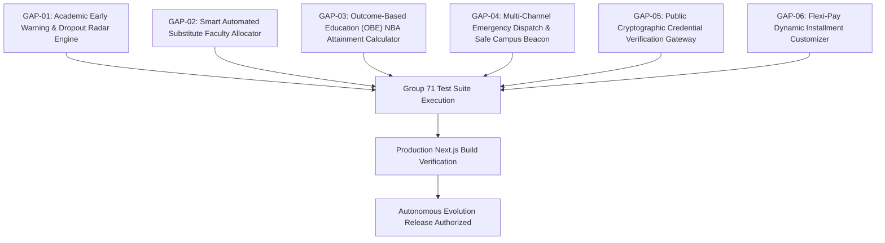

# CLASSROOM ERP — Autonomous Feature Evolution & Gap Matrix

**Document Reference:** `DOC-AUTONOMOUS-ERP-GAP-MATRIX-2026`  
**Architecture Lead:** Principal Software Architect & Product Engineering Council  
**Last Updated:** Academic Session 2026–2027  
**Status:** Active Implementation Backlog

---

## 1. Prioritization Criteria

- **P0:** Security vulnerabilities, data corruption, broken core workflows, authorization failures, and critical build/runtime failures.
- **P1:** Essential missing functionality, major integration failures, and high-impact institutional capabilities.
- **P2:** Important enhancements, productivity improvements, advanced reporting, and competitive market-winning features.
- **P3:** Optional innovations, advanced personalization, and lower-impact polish.

---

## 2. Autonomous Gap Identification & Resolution Matrix

| Gap ID | Module & User Roles | Existing Behavior & Evidence | Missing / Defective Capability | Competitor Benchmark | Priority | Proposed Technical Solution | Implementation Status | Test Suite & Verification |
| :---: | :--- | :--- | :--- | :--- | :---: | :--- | :---: | :--- |
| **GAP-01** | **Academic Early Warning & Retention** (*Roles: Principal, HOD, Faculty Mentor, Student*) | Only static attendance percentage (`attendanceRate < 75%`) is checked at end of term. | Lacks multi-factor predictive dropout radar combining attendance velocity, CIA score dip, fee arrears, and LMS delays into an actionable 0-100 risk score with counselor intervention workflows. | **PowerSchool Unified Insights / Ellucian Degree Works** | **P1** | Implement `early-warning-engine.ts` with weighted multi-factor risk index and proactive intervention lifecycle (`src/app/api/analytics/early-warning/route.ts`). | **In Progress** | Group 71 Test: Risk index scoring, critical factor explanation, intervention logging. |
| **GAP-02** | **Faculty Operations & Scheduling** (*Roles: Dean, HOD, Faculty*) | When a faculty member takes casual/medical leave, substitute allocation is completely manual with no clash detection. | Lacks automated constraint-solving substitute teacher allocator enforcing subject expertise, zero timetable clash, and AICTE maximum 16/18 weekly teaching credit caps. | **Fedena Timetable / Teachmint Smart Scheduler** | **P1** | Implement `smart-substitution-engine.ts` matching department, evaluating daily/weekly slots, checking workload limits, and issuing automatic substitution passes. | **In Progress** | Group 71 Test: Substitution candidate ranking, clash prevention, credit cap enforcement. |
| **GAP-03** | **Curriculum & Accreditation (OBE)** (*Roles: Exam Controller, IQAC Director, HOD*) | Basic Bloom taxonomy levels exist in OBE engine, but CO-PO attainment calculation is manual on spreadsheets. | Lacks automated Direct + Indirect attainment calculator and 1-click NBA SAR (Self-Assessment Report) Criterion 3 & 4 Matrix generator. | **Canvas Mastery Gradebook / InPods OBE** | **P1** | Expand `obe-engine.ts` with rubric threshold attainment algorithm (Direct 80% + Indirect 20%) and auto-synthesize complete NBA SAR matrices in `examinations/co-po`. | **In Progress** | Group 71 Test: Direct attainment thresholds, weighted PO attainment, NBA matrix generation. |
| **GAP-04** | **Campus Safety & Clery Compliance** (*Roles: Campus Security, Dean, All Scholars*) | Campus emergency only tracks static muster headcounts without active multi-channel alerts or student check-ins. | Lacks instant multi-channel emergency broadcast dispatcher (SMS, WhatsApp, In-App Banner, Email) and real-time interactive "I am Safe" / "Need Help" safety beacon. | **Rave Mobile Safety / Blackboard Mass Notification** | **P1** | Implement `emergency-broadcast-engine.ts` with Clery Act incident logging, multi-channel simulated dispatch, and scholar safety beacon registration API. | **In Progress** | Group 71 Test: Emergency playbook dispatch, multi-channel fan-out, safety beacon registration. |
| **GAP-05** | **Institutional Credentials & Registry** (*Roles: Public Employers, Embassies, Alumni*) | Transcripts and degrees can only be viewed inside an authenticated user session. | External verifiers (background screening agencies, foreign universities, visa consulates) cannot verify credentials without ERP login credentials. | **National Student Clearinghouse / Certif-ID** | **P1** | Implement public, rate-limited `/api/verify/credential` endpoint and public verification page `/verify/[credentialId]` with SHA-256 seal validation. | **In Progress** | Group 71 Test: Public credential retrieval, signature verification, zero PII leak guarantee. |
| **GAP-06** | **Bursar & Flexible Student Billing** (*Roles: Accountant, Bursar, Parent, Student*) | Fee structures have fixed installment splits; bursars cannot customize payment schedules for hardship cases. | Lacks dynamic flexi-pay installment plan customizer allowing custom percentage splits (e.g. 40-30-30), customized due date milestones, and hardship moratorium flags. | **PowerSchool e~Funds / Classter Billing** | **P2** | Implement custom installment schedule builder in `finance-engine.ts` and `src/app/api/finance/installments/route.ts` with audit-logged concessions. | **In Progress** | Group 71 Test: Custom split percentage validation, milestone generation, fee arrears deduction. |

---

## 3. Implementation Phasing Strategy

